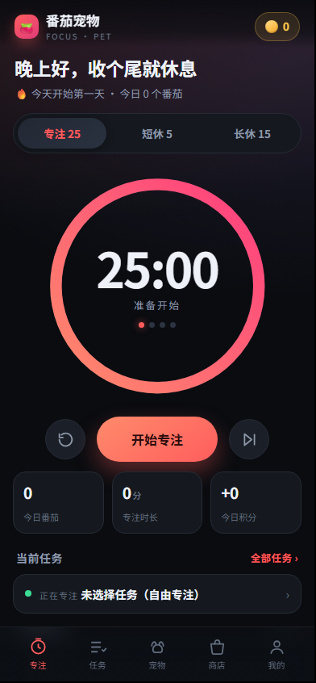
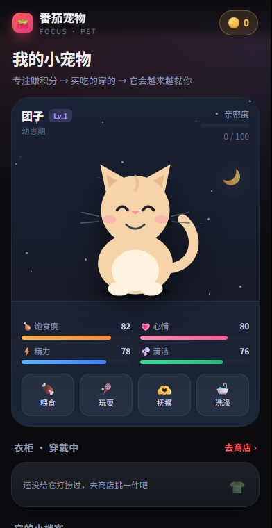
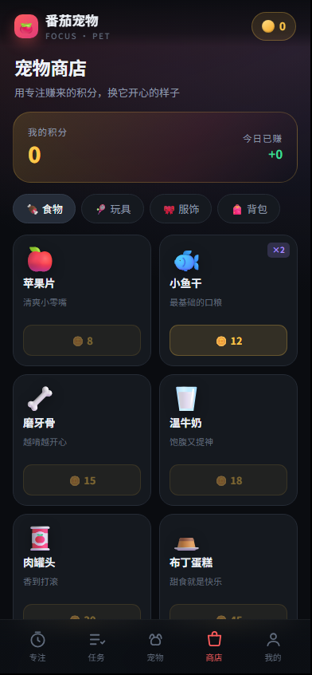
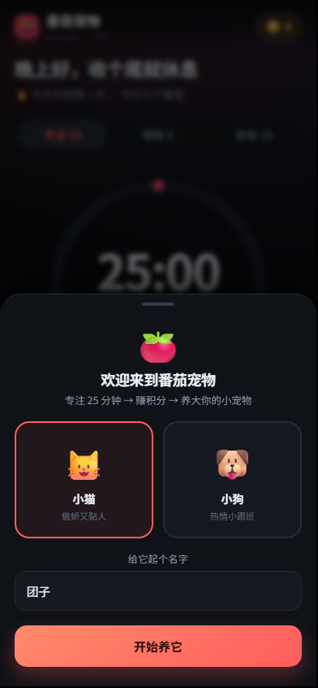
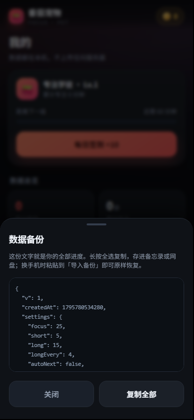

# 🍅 番茄宠物 · FocusPet

一个**真 Android APK**（不是网页套壳 PWA）：番茄钟计时 + 积分 + 虚拟宠物养成 + 商店兑换。
界面用 WebView 承载本地 H5（离线可用、无任何服务器），原生侧补齐网页做不到的能力：**精确闹钟到点通知、震动、计时期间屏幕常亮、常驻后台不丢时间**。

- 安装包：**[FocusPet-v1.0.apk](https://github.com/lechangdeliaoji/focuspet/raw/main/FocusPet-v1.0.apk)**（约 166 KB）
- 包名：`com.focuspet.tomato` / minSdk 24（Android 7.0+）/ targetSdk 34
- 完全离线运行，所有数据只存在手机本地

<p align="center">
  
  
  
</p>
<p align="center">
  
  
</p>

---

## 一、安装

1. 手机浏览器打开 **[下载链接](https://github.com/lechangdeliaoji/focuspet/raw/main/FocusPet-v1.0.apk)** 直接下载，或用数据线 / 微信文件传输 / 网盘把 `FocusPet-v1.0.apk` 传到手机。
2. 点击安装，若提示「禁止安装未知来源应用」，在弹窗里选择「设置 → 允许来自此来源」再返回继续。
3. 首次启动会请求**通知权限**（Android 13+），请允许 —— 否则到点没有提醒。
4. 想开**精确闹钟**：设置 → 应用 → 番茄宠物 → 闹钟和提醒 → 允许。没有开启也能用，只是系统可能把提醒延迟几十秒。

> 装到模拟器：`adb install -r FocusPet-v1.0.apk`
> 卸载重装不会保留数据，换机前先「我的 → 导出备份」复制那段文字。

---

## 二、核心玩法

### 1. 番茄钟（专注页）

| 模式 | 默认时长 | 说明 |
|---|---|---|
| 专注 | 25 分钟 | 完成后结算积分 |
| 短休息 | 5 分钟 | 每完成 1 个番茄后自动进入 |
| 长休息 | 15 分钟 | 每 4 个番茄（`longEvery`）后进入 |

- 圆环是倒计时进度，点「开始专注 / 暂停 / 继续」；⏱ 重置、⏭ 跳过。
- 计时中手机锁屏或退到后台都不影响：到点由**系统闹钟**发通知 + 震动 + 亮屏，时间不会因为 WebView 被冻结而漂移。
- 计时期间屏幕保持常亮（可在设置里关声音/震动）。

### 2. 积分规则（激励系统）

| 行为 | 积分 |
|---|---|
| 完成 1 个专注番茄 | **+10** 基础 |
| 时长 ≥ 30 分钟 | +4 |
| 时长 ≥ 45 分钟 | +8 |
| 番茄绑定了任务 | +2 |
| 每第 4 个番茄（一轮循环） | **+15** 四连击 |
| 勾选完成一条任务 | +5 |
| 每日签到 | +10，连续第 N 天 +2×N（封顶 +20） |
| 当日番茄数达标（默认 8 个） | +20 |

积分只增不减的部分记在 `totalPomodoros / totalFocusMin / streak`，用于等级与统计。

### 3. 宠物（宠物页）

- 开局在小猫 / 小狗里选一只，可以起名字，之后能在「我的 → 宠物」里换毛色和种类。
- 四条状态：**饱食度 / 心情 / 精力 / 清洁**，随时间自然下降（离线也照算，最多累计 72 小时）。
- 四个互动：喂食（消耗食物）、玩耍（消耗玩具）、抚摸（免费 +心情）、洗澡（+清洁）。
- **成长阶段**：幼崽期 → 少年期（亲密 100）→ 成年期（260）→ 挚友期（500）。亲密值来自每次专注陪伴与互动。
- 心情好时会笑、摇尾巴；饿了会耷拉耳朵、掉眼泪（SVG 手绘，无图片资源）。

### 4. 商店（商店页）

四个分类：食物 / 玩具 / 服饰 / 背包。

- 食物：苹果片 8、小鱼干 12、磨牙骨 15、温牛奶 18、肉罐头 30、布丁蛋糕 45、牛排 80
- 玩具：气球 25、毛线球 35、逗猫棒 55、飞盘 60、拼图 90
- 服饰：铃铛 120、项圈 150、蝴蝶结 180、小帽子 240、领巾 260、派对帽 300、项链 420、圆眼镜 500、皇冠 600
- 服饰分 `neck / head / eyes` 三个槽位，可同时穿戴；已购的从「背包」里点「穿戴 / 取下」。
- 积分不够时直接提示还差多少，不会扣分。

### 5. 任务（任务页）

- 输入框回车即建任务；筛选「进行中 / 已完成 / 全部」。
- 点 ▶ 把番茄绑定到这个任务（结算多 +2）；点勾选框标记完成（+5）。
- 任务卡片显示 `🍅 已用番茄数 / 预计番茄数`。

### 6. 我的（我的页）

等级卡（累计专注分钟 ÷ 60 升 1 级，每 3 级换称号）、每日签到、数据总览（累计番茄 / 累计分钟 / 最长连续 / 完成任务）、最近记录、设置（时长、宠物、声音、震动、导出/导入备份、清空数据）。

---

## 三、数据与备份

- 存储：`localStorage`，键名 `focuspet.state.v1`，只在本机。
- **导出备份**：我的 → 导出备份 → 弹层里那段 JSON 就是全部进度，长按全选复制存起来即可（WebView 不支持直接下载文件，所以做成可复制文本）。
- **导入备份**：我的 → 导入备份 → 把 JSON 整段粘贴 → 恢复进度。
- 清空数据不可恢复，会二次确认。

---

## 四、权限

| 权限 | 用途 |
|---|---|
| `POST_NOTIFICATIONS` | 到点通知（Android 13+ 需授权） |
| `SCHEDULE_EXACT_ALARM` / `USE_EXACT_ALARM` | 精确到秒的到点提醒 |
| `VIBRATE` | 到点与操作震动 |
| `WAKE_LOCK` | 闹钟触发时唤醒屏幕 |
| `INTERNET` | **不联网**，仅 WebView 常规声明，全部资源都在 APK 内 |

---

## 五、自己构建

工具链不依赖 Gradle / Android Studio，用 aapt2 + javac + d8 + zipalign + apksigner 手工打包。

```bash
bash build.sh
```

脚本会依次：同步 H5 → `aapt2 compile/link` → `javac` → `d8` → 追加 `classes.dex` 与 `assets/www` → `zipalign -p 4` → `apksigner sign`（首次自动生成 `android/debug.keystore`，密码 `focuspet`）→ 校验，产物为 `FocusPet-v1.0.apk`。

需要先准备好（路径写在 `build.sh` 顶部）：

```
_env/sdk/jdk                        # JDK 17
_env/sdk/build-tools/android-14     # build-tools 34.0.0
_env/sdk/platforms/android-35/android.jar
```

### 目录结构

```
pomodoro-pet/
├── index.html / styles.css / app.js / pet.js   # H5 界面与全部玩法逻辑
├── icons/                                      # 应用图标（H5 + mipmap 共用）
├── docs/screenshots/                           # README 展示截图
├── android/
│   ├── AndroidManifest.xml
│   ├── java/com/focuspet/tomato/
│   │   ├── MainActivity.java      # WebView 外壳、通知渠道、闹钟调度
│   │   ├── TimerBridge.java       # JS ↔ 原生（scheduleAlarm/vibrate/awake/toast）
│   │   ├── AlarmReceiver.java     # 闹钟到点 → 亮屏 + 通知
│   │   └── NotificationHelper.java
│   └── res/                        # 图标、颜色、主题、通知小图标
├── tools/
│   ├── GenIcon.java               # Java2D 生成各密度图标
│   ├── pack.py                    # 往 APK 里追加 dex 与 assets
│   ├── _probe.html                # 布局自检（390×844 iframe 溢出检测）
│   ├── _test.html                 # 玩法冒烟测试（24 项断言）
│   ├── CropShots.java             # 截图裁切成手机宽度（docs 用）
│   ├── gh_push.py                 # 走 Git Data API 推快照（github.com:443 不通时可用）
│   └── gh_release.py              # 建 Release 并上传 APK asset
└── build.sh
```

---

## 六、已知限制

- 头像/宠物是手写 SVG，没有位图素材，所以包体极小；换宠物只是换配色与耳朵/口鼻形状。
- 备份靠复制文本，不支持直接写文件（WebView 沙箱限制）。
- 桌面浏览器也能打开 `index.html` 玩，但到点提醒只有页面内的提示音，没有系统通知。
- 应用被系统「强行停止」后，已排定的闹钟会被清除，重新打开 App 恢复计时即可。
